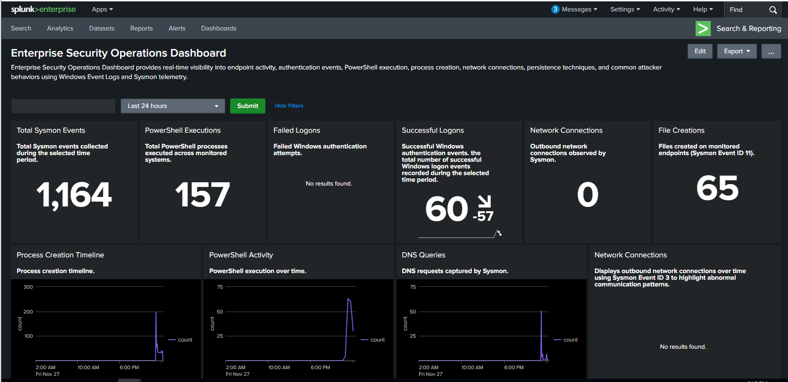
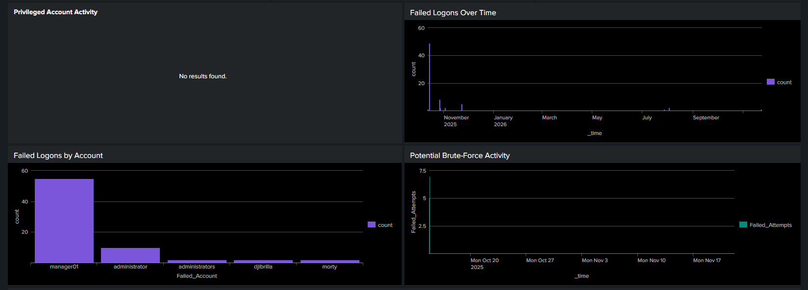

# SOC Windows Security Monitoring & Threat Detection Lab

A hands-on Security Operations Center (SOC) lab built with **Splunk Enterprise, Windows Server 2019, Sysmon, and Windows Security Event Logs**. This project demonstrates security monitoring, threat detection, authentication analysis, incident investigation, and SIEM dashboard development.

## 1. Project Overview

The objective of this project is to simulate SOC analyst responsibilities by collecting endpoint telemetry, analyzing Windows security events, developing detection rules, and investigating suspicious activity.

The lab focuses on identifying potential security threats, including:

- Brute-force authentication attempts
- Failed and successful Windows logons
- Suspicious account activity
- PowerShell execution
- Encoded PowerShell commands
- Suspicious process creation
- Registry-related activity
- Potentially abnormal network connections

## 2. Lab Architecture

| Component | Technology |
|---|---|
| SIEM | Splunk Enterprise |
| Operating System | Windows Server 2019 |
| Endpoint Monitoring | Sysmon |
| Security Telemetry | Windows Event Logs |
| Log Analysis | SPL (Search Processing Language) |
| Detection Engineering | Custom SPL searches |
| Documentation | Markdown and GitHub |

### Architecture Overview

1. Windows Server generates security and system events.
2. Sysmon captures endpoint activity, including process creation and network connections.
3. Windows Security Event Logs capture authentication activity.
4. Logs are collected and analyzed in Splunk Enterprise.
5. SPL searches identify suspicious patterns.
6. Investigation documentation records findings and validation results.


## 3. Enterprise Security Operations Dashboard

The Splunk dashboard provides an overview of endpoint activity and security monitoring.

### Main SOC Dashboard



### Authentication and Threat Detection Dashboard



Dashboard panels include:

- Total Sysmon Events
- PowerShell Executions
- Failed Logons
- Successful Logons
- Network Connections
- File Creations
- Process Creation Timeline
- PowerShell Activity
- DNS Queries
- Privileged Account Activity
- Failed Logons by Account
- Potential Brute-Force Activity

Dashboard results depend on the selected time range and the availability of matching telemetry.

## 4. Detection Engineering

Custom SPL searches were developed to identify suspicious endpoint and authentication activity.

| Detection | Description |
|---|---|
| Windows Brute-Force Detection | Identifies repeated failed authentication attempts. |
| Encoded PowerShell | Supports investigation of potentially suspicious encoded commands. |
| Registry Utility Investigation | Examines potentially suspicious registry-related activity. |
| Process Creation Analysis | Investigates process execution and parent-child relationships. |

### Example: Windows Brute-Force Detection

The detection analyzes Windows Security Event ID 4625 and groups failed logons by time, source IP, and targeted account.

```spl
index=* host="MOUCTAR-SERV19"
source="WinEventLog:Security" EventCode=4625
| rex field=_raw "Source Network Address:\s+(?<Source_IP>[^\r\n]+)"
| rex field=_raw "(?s)Account For Which Logon Failed:.*?Account Name:\s+(?<Failed_Account>[^\r\n]+)"
| eval Failed_Account=lower(trim(Failed_Account))
| bin _time span=10m
| stats count as Failed_Attempts by _time Source_IP Failed_Account
| where Failed_Attempts>=5
| timechart span=1d sum(Failed_Attempts) as Failed_Attempts by Source_IP
```

## 5. Security Investigations

The investigations directory contains documented analysis of authentication events and suspicious activity.

| Investigation | Focus |
|---|---|
| Windows Failed Logon Analysis | Event ID 4625 and failed authentication attempts |
| Windows Successful Logon Analysis | Event ID 4624 and successful authentication |
| Authentication Correlation | Correlating failed and successful authentication |
| Authentication Correlation Detection | Identifying suspicious authentication sequences |
| Brute-Force Validation | Validating detection logic against authentication events |

### Investigation Evidence

Screenshots documenting the investigations are available in `docs/Screenshots/`.

1. Failed Authentication Monitoring
2. Targeted Account Analysis
3. Brute-Force Detection
4. Successful Login Analysis
5. Authentication Event Analysis
6. Failed-Successful Authentication Correlation

## 6. Windows Security Event Analysis

The lab uses Windows Security Event IDs to investigate authentication behavior.

| Event ID | Description |
|---|---|
| 4624 | Successful account logon |
| 4625 | Failed account logon |

The lab also uses Sysmon telemetry to investigate endpoint behavior.

| Sysmon Event ID | Description |
|---|---|
| 1 | Process Creation |
| 3 | Network Connection |
| 11 | File Creation |

These events help establish context when investigating potentially suspicious activity.

## 7. Repository Structure

```text
SOC-Windows-Security-Lab/
│
├── detections/
│   ├── encoded-powershell.md
│   ├── registry-utility-investigation.md
│   └── windows-brute-force-detection.spl
│
├── docs/
│   ├── architecture.md
│   └── Screenshots/
│       ├── 1. Failed Authentication Monitoring.png
│       ├── 2. Targeted Account Analysis.png
│       ├── 3-brute-force-detection.png
│       ├── 4-successful-login-analysis.png
│       ├── 5-authentication-event-analysis.png
│       └── 6-failed-successful-correlation.png
│
├── investigations/
│   ├── windows-authentication-failure-analysis/
│   │   ├── README.md
│   │   └── brute-force-detection-validation.md
│   ├── authentication-correlation-detection.md
│   ├── windows-authentication-correlation.md
│   ├── windows-failed-logon-analysis.md
│   └── windows-successful-logon-analysis.md
│
├── splunk/
│   ├── dashboards/
│   │   ├── enterprise-security-operations-dashboard.md
│   │   ├── enterprise-security-operations-dashboard.png
│   │   └── enterprise-security-operations-dashboard2.png
│   │
│   └── searches/
│       ├── cmd-child-process-analysis.md
│       └── process-creation-summary.md
│
└── README.md
```

## 8. Skills Demonstrated

**Security Operations**
- SIEM monitoring and log analysis
- Security event investigation
- Threat detection and validation
- Authentication monitoring
- Incident investigation

**Technical Skills**
- Splunk Enterprise
- Search Processing Language (SPL)
- Windows Server 2019
- Sysmon
- Windows Event Logs
- PowerShell
- Process and network activity analysis
- Git and GitHub documentation

## 9. Project Objectives and Learning Outcomes

Through this project, I developed practical experience with:

- Building and configuring a Windows security monitoring environment.
- Collecting and analyzing endpoint telemetry.
- Writing custom SPL detection searches.
- Investigating failed and successful authentication events.
- Correlating authentication activity to identify suspicious patterns.
- Developing dashboards to visualize security events.
- Documenting detection logic and investigation findings.

## 10. Future Improvements

Potential enhancements include:

- Integrating Active Directory authentication monitoring.
- Expanding detection coverage for privilege escalation.
- Developing additional Sysmon-based threat detections.
- Improving alert severity and risk scoring.

## Disclaimer

This project is an educational cybersecurity lab developed for hands-on learning and professional development. All testing and simulated security activities are conducted within a controlled lab environment.

---

**Author:** Djibrilla Mouctar  
**Project:** SOC Windows Security Monitoring & Threat Detection Lab  
**Technologies:** Splunk Enterprise | Windows Server 2019 | Sysmon | SPL | Windows Security Event Logs
