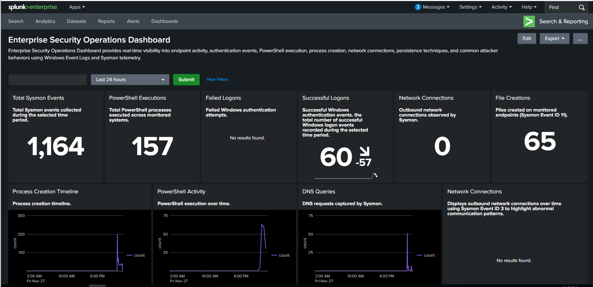
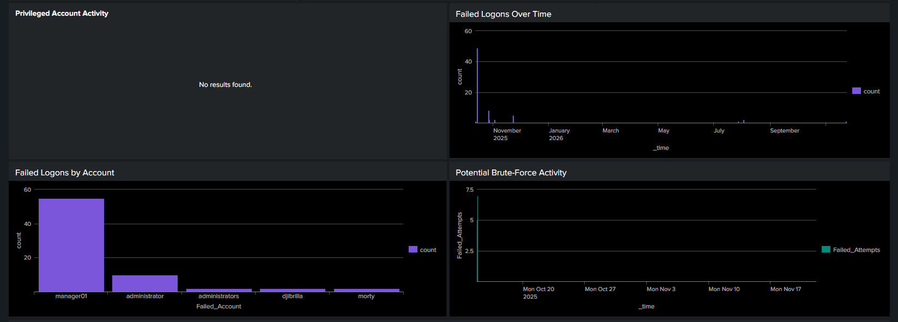

# Enterprise Security Operations Dashboard

## 1. Project Overview

The Enterprise Security Operations Dashboard is a centralized security monitoring and threat investigation dashboard developed using Splunk Enterprise.

The dashboard integrates Windows Security Event Logs and Sysmon telemetry to provide visibility into endpoint activity, authentication events, PowerShell execution, process creation, DNS queries, network connections, and file activity.

The purpose of this project is to simulate practical Security Operations Center (SOC) activities, including security monitoring, threat hunting, detection engineering, log analysis, and incident investigation.

The lab focuses on understanding how Windows security events are generated, collected, analyzed, and investigated using Splunk Search Processing Language (SPL).

## 2. Lab Environment

| Component | Technology | Purpose |
|---|---|---|
| SIEM | Splunk Enterprise | Centralized security monitoring and log analysis |
| Operating System | Windows Server 2019 | Server and domain infrastructure |
| Endpoint Monitoring | Sysmon | Detailed endpoint activity collection |
| Authentication Monitoring | Windows Security Logs | Successful and failed authentication tracking |
| Identity Management | Active Directory | Centralized user and account management |
| Configuration Management | Group Policy | Centralized Windows security configuration |
| Network Security | pfSense | Network routing and firewall management |
| Network Services | DNS and DHCP | Name resolution and IP address assignment |

## 3. Data Sources

The project uses the following sources of security telemetry:

| Data Source | Security Information |
|---|---|
| Windows Security Logs | Authentication, account activity, and security events |
| Windows System Logs | Operating system and service activity |
| Sysmon | Process creation, network connections, DNS queries, and file activity |
| Splunk Enterprise | Log searching, event correlation, detection, and visualization |

### Important Windows Event IDs

| Event ID | Description |
|---|---|
| 4624 | Successful logon |
| 4625 | Failed logon |
| 4634 | Account logged off |
| 4672 | Special privileges assigned to a new logon |
| 4627 | Group membership information |

### Important Sysmon Event IDs

| Event ID | Description |
|---|---|
| 1 | Process creation |
| 3 | Network connection |
| 11 | File creation |
| 22 | DNS query |

## 4. Enterprise Security Operations Dashboard

The primary dashboard provides centralized visibility into Windows endpoint activity and security events.

Dashboard screenshots:



### 4.1 Security Overview

The overview section provides key monitoring metrics, including:

- Total Sysmon Events
- PowerShell Executions
- Failed Logons
- Successful Logons
- Network Connections
- File Creations

These metrics help provide an overview of endpoint activity during the selected time range.

Dashboard values change depending on the selected time range and available events.

### 4.2 Process Creation Timeline

Displays process creation activity over time using Sysmon Event ID 1.

This panel supports investigations involving:

- Unexpected executable activity.
- Unusual process execution patterns.
- Suspicious parent-child process relationships.
- Unexpected program execution.

### 4.3 PowerShell Activity

Tracks PowerShell execution activity across monitored systems.

This panel supports investigations involving:

- Unusual PowerShell execution.
- Potentially encoded commands.
- Suspicious command-line arguments.
- Unexpected PowerShell activity.

### 4.4 DNS Queries

Displays DNS requests captured through Sysmon Event ID 22.

This panel helps investigate domain resolution activity and identify potentially unusual DNS communication patterns.

### 4.5 Network Connections

Displays network connections observed through Sysmon Event ID 3.

This panel provides visibility into endpoint network activity and can help identify unexpected communication.

### 4.6 File Creations

Monitors file creation activity using Sysmon Event ID 11.

This panel helps identify newly created files and provides additional context for investigating potentially suspicious endpoint activity.

## 5. Authentication Monitoring Dashboard

A second dashboard was developed to provide additional visibility into Windows authentication activity.



The dashboard includes the following investigation panels:

### 5.1 Privileged Account Activity

Provides visibility into activity involving privileged accounts.

This helps investigate administrative account usage and potentially unusual access patterns.

### 5.2 Failed Logons Over Time

Displays failed Windows authentication attempts over time using Security Event ID 4625.

This panel helps identify changes in authentication failure patterns.

### 5.3 Failed Logons by Account

Identifies accounts associated with failed authentication attempts.

This supports investigations involving:

- Repeated authentication failures.
- Targeted user accounts.
- Potential password guessing.
- Suspicious account access patterns.

### 5.4 Potential Brute-Force Activity

Provides visibility into repeated failed authentication attempts that may indicate potential brute-force behavior.

The investigation considers:

- Failed authentication frequency.
- Targeted accounts.
- Source IP addresses.
- Event timestamps.
- Repeated authentication attempts within a time window.

A high number of failed attempts should be investigated further before being classified as a brute-force attack.

## 6. Authentication Investigation and Event Correlation

Authentication investigations were performed using Windows Security Events and Splunk SPL.

The investigations focused on correlating successful and failed authentication activity.

### 6.1 Failed Authentication Investigation

Windows Security Event ID 4625 was used to investigate failed logon attempts.

The investigation included:

- Extracting failed account names.
- Identifying source network addresses.
- Counting repeated authentication failures.
- Grouping events into time windows.
- Identifying potentially targeted accounts.

### 6.2 Successful Authentication Investigation

Windows Security Event ID 4624 was used to investigate successful logons.

The investigation included:

- Extracting successful account names.
- Identifying logon types.
- Examining source addresses.
- Filtering system and machine accounts.
- Reviewing authentication activity over time.

### 6.3 Failed-to-Successful Authentication Correlation

Successful and failed authentication events were correlated to identify successful logons occurring shortly after failed authentication attempts.

The investigation used event timestamps, account names, and source IP addresses.

One correlation search identified seven matching events in the observed results.

This analysis demonstrates how authentication events can be combined to provide additional context during security investigations.

### 6.4 Brute-Force Detection Validation

A dedicated SPL detection query was developed and documented in:

`detections/windows-brute-force-detection.spl`

The detection analyzes repeated failed authentication attempts using:

- Event ID 4625.
- Source IP addresses.
- Targeted account names.
- Ten-minute aggregation windows.
- A threshold of five or more failed attempts.

The detection was tested against available lab events.

The results included loopback traffic, which required additional filtering to avoid treating local authentication activity as external attack traffic.

The validation process also demonstrated the importance of reviewing event context and tuning detection logic to reduce false positives.

## 7. Additional Security Investigations

Beyond authentication monitoring, additional investigation documents and SPL searches were developed.

### 7.1 Encoded PowerShell Investigation

File: `detections/encoded-powershell.md`

Documents investigation of potentially encoded PowerShell commands and suspicious execution patterns.

### 7.2 Registry Utility Investigation

File: `detections/registry-utility-investigation.md`

Documents investigation of Windows Registry utility activity and potentially suspicious registry operations.

### 7.3 Command-Line and Child Process Analysis

File: `splunk/searches/cmd-child-process-analysis.md`

Documents process relationships and command-line activity that can help identify suspicious execution behavior.

### 7.4 Process Creation Summary

File: `splunk/searches/process-creation-summary.md`

Documents process creation activity and provides a starting point for investigating unusual executable behavior.

### 7.5 LOLBins Monitoring

Living Off the Land Binaries (LOLBins) are legitimate Windows utilities that attackers may abuse to execute commands, download files, modify system configurations, or evade detection.

The following utilities were identified as monitoring targets:

| Utility | Potential Abuse |
|---|---|
| `certutil.exe` | Downloading or decoding files |
| `reg.exe` | Modifying Windows Registry settings |
| `rundll32.exe` | Executing DLL-based code |
| `mshta.exe` | Executing HTA scripts |
| `wmic.exe` | Executing remote commands and system management operations |

The investigation focuses on command-line arguments, parent-child process relationships, execution context, and associated user accounts.

The presence of these utilities does not automatically indicate malicious activity.

## 8. Repository Documentation Structure

The project documentation and supporting files are organized as follows:

```text
SOC-Windows-Security-Lab/
│
├── detections/
│   ├── encoded-powershell.md
│   ├── registry-utility-investigation.md
│   └── windows-brute-force-detection.spl
│
├── docs/
│   ├── architecture.md
│   └── Screenshots/
│       ├── 1. Failed Authentication Monitoring.png
│       ├── 2. Targeted Account Analysis.png
│       ├── 3-brute-force-detection.png
│       ├── 4-successful-login-analysis.png
│       ├── 5-authentication-event-analysis.png
│       └── 6-failed-successful-correlation.png
│
├── investigations/
│   ├── windows-authentication-failure-analysis/
│   ├── authentication-correlation-detection.md
│   ├── windows-authentication-correlation.md
│   ├── windows-failed-logon-analysis.md
│   └── windows-successful-logon-analysis.md
│
├── splunk/
│   ├── dashboards/
│   │   ├── enterprise-security-operations-dashboard.md
│   │   ├── enterprise-security-operations-dashboard.png
│   │   └── enterprise-security-operations-dashboard2.png
│   │
│   ├── searches/
│   │   ├── cmd-child-process-analysis.md
│   │   └── process-creation-summary.md
│   │
│   └── README.md
│
└── README.md
```

